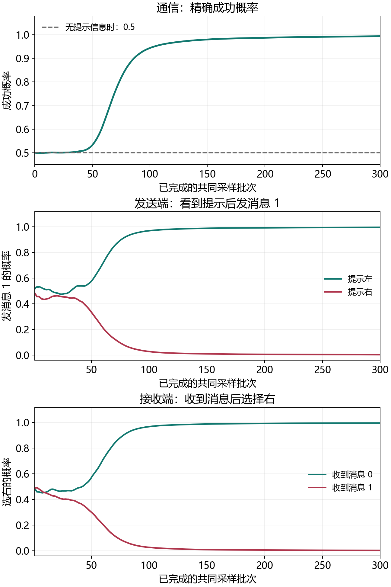

# MARL · 多智能体强化学习实践

RedMoon 的多智能体强化学习练习，按学习顺序保留 Day6–Day10 编号。每份练习都有分段中文说明、可直接执行的 Python 源码、Notebook 和实际运行结果。从共同奖励出发，依次观察集中训练、价值分解、连续动作、局部记忆与离散通信。

## 开始运行

本仓库在 Python 3.13.5 / PyTorch 2.11.0 的 CPU 环境核验，使用自定义小环境。无需下载数据、调用 API 或安装 Gym；绘图由 Matplotlib 完成。

```bash
git clone https://github.com/Redmoon-2333/MARL.git
cd MARL
python -m venv .venv
```

激活环境：Windows PowerShell 使用 `.venv\Scripts\Activate.ps1`；Linux/macOS 使用 `source .venv/bin/activate`。然后安装依赖并检查入口：

```bash
python -m pip install torch==2.11.0 --index-url https://download.pytorch.org/whl/cpu
python -m pip install -r requirements.txt
python scripts/marl.py check
python scripts/marl.py list
```

先运行一次 CTDE 数据流，再接完整训练：

```bash
python scripts/marl.py run ctde
python scripts/marl.py run mappo
python scripts/marl.py run all --engine script
```

统一入口将终端输出、机器可读摘要和训练图写入新建的 `runs/日期时间/`，不覆盖练习文件。运行 Notebook 引擎前注册当前环境内核：

```bash
python -m ipykernel install --user --name python3 --display-name "Python 3 (MARL)"
python scripts/marl.py run recurrent-communication --engine notebook
```

也可以在支持 Notebook 的编辑器中打开 `.ipynb`，选择当前环境并从头运行；或者直接运行下表对应的 `.py`，此时训练图由本机绘图后端显示。

## 学习与代码

| 内容 | Notebook | Python 源码 | 阅读 |
|---|---|---|---|
| Day6：CTDE 的输入与梯度分工 | [一次更新](Day6/11_CTDE_dataflow_test.ipynb) | [源码](Day6/11_CTDE_dataflow_test.py) | [Day6 笔记](docs/Day6.md) |
| Day6：一步灯控合作与逐角色 PPO | [完整训练](Day6/12_MAPPO_training_test.ipynb) | [源码](Day6/12_MAPPO_training_test.py) | [实验说明](docs/experiments.md#day6) |
| Day6：从奖励学习消息协议 | [完整通信训练](Day6/13_communication_training_test.ipynb) | [源码](Day6/13_communication_training_test.py) | [消息机制](docs/Day6.md) |
| Day7：共同 TD 损失与目标同步 | [一次更新](Day7/14_QMIX_single_step_update_test.ipynb) | [源码](Day7/14_QMIX_single_step_update_test.py) | [Day7 笔记](docs/Day7.md) |
| Day7：两层单调 Mixer 与联合回放 | [完整训练](Day7/15_QMIX_training_test.ipynb) | [源码](Day7/15_QMIX_training_test.py) | [实验说明](docs/experiments.md#day7) |
| Day8：MADDPG 风格连续协调 | [完整训练](Day8/16_MADDPG_training_test.ipynb) | [源码](Day8/16_MADDPG_training_test.py) | [Day8 笔记](docs/Day8.md) |
| Day9：GRU 记忆与循环 PPO | [完整训练](Day9/17_Recurrent_MAPPO_memory_test.ipynb) | [源码](Day9/17_Recurrent_MAPPO_memory_test.py) | [Day9 笔记](docs/Day9.md) |
| Day10：双方私有线索与延迟通信 | [完整训练](Day10/18_Recurrent_communication_test.ipynb) | [源码](Day10/18_Recurrent_communication_test.py) | [实验指南](docs/experiments.md#day10) |

Day6–Day9 笔记可独立阅读，正文已摘取关键代码、张量解释和结果图。Day10 的模块说明与输出解读位于 Notebook、分段源码及实验指南。单智能体的 PPO/GAE 前置内容见 [Day5 阅读文章](https://redmoon-2333.github.io/2026/10/07/rl-day5-ppo-training/)。



## 怎样理解这些实验

灯控和连续数值对齐任务可通过共同约定解决，演示共同奖励如何训练局部决策。Day9 让私有提示在选择前消失，检验本局记忆。Day6 的方向消息任务，以及 Day10 的私有线索 XOR 任务，则要求把信息真正送到接收者。

CTDE 与单次 QMIX 更新练习用于观察数据和梯度。其余六份练习包含环境交互、训练和冻结评估。MAPPO、QMIX 与 MADDPG 采用适合小环境的教学实现；具体网络、采样方式和信息条件见[实验指南](docs/experiments.md)。COMA 的反事实优势只在笔记中作数值解释，当前训练没有实现 COMA。

代码在互动学习中由教师提供骨架，RedMoon 复跑、提问并逐步修改。算法机制可对应原论文阅读；仓库中的单种子结果用于核验当前练习，不作为不同算法的性能排名。

## 维护与验证

```bash
# 校验 Notebook 格式、代码语法、源码一致性和相对链接
python scripts/marl.py check

# 为缺少源码的 Notebook 导出带分段说明的 .py；保留已有同源源码的注释
python scripts/marl.py export

# 用干净内核完整执行八份 Notebook，结果存到指定的新目录
python scripts/marl.py run all --engine notebook --output runs/notebook-check
```

八份练习包含 **291 项机制与结果检查**，涉及样本对应、真实终止、训练梯度、目标网络、分散执行和信息干预。GitHub Actions 使用 CPU 完整执行八份源码，并额外执行 Day10 Notebook，结果可从工作流附件下载。每次运行的 `report.json` 记录环境版本、源码哈希、耗时、检查数和实际摘要。

2026-10-16 已在上述 CPU 环境分别完整执行八份源码和八份 Notebook，两种入口各通过 291 项检查，逐份运行摘要一致；维护入口的四项回归测试通过。[本次核验数据](docs/validation.json)保留源码哈希、耗时与实际结果。

| 冻结评估任务 | 本次结果 |
|---|---|
| Day6 灯控合作 | 精确成功概率 0.996912；采样成功 496/500 |
| Day6 方向通信 | 精确成功概率 0.993793；消息固定后约 0.5 |
| Day7 两轮灯控 | 四起点完整成功；独立起点采样 500/500，折扣回报 1.9 |
| Day8 连续对齐 | 固定起点平均差 0.809328 → 0.018731；500 局均满足两轮差≤0.1 |
| Day9 提示记忆 | 精确成功概率 0.25 → 0.999879；决策前清空记忆后 0.25 |
| Day10 延迟通信 | 精确成功概率约 0.5 → 0.999988；消息或关键记忆干预后约 0.5 |

修改练习时要同步 Notebook 与 `.py` 的代码单元；`check` 会拒绝代码不一致的版本。训练配置位于每份练习的首个代码单元。默认验收阈值与训练量配套，缩短训练后应按新的输出解释结果。
