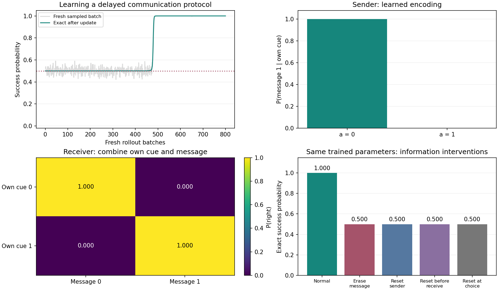

# Day10 · 记住线索，再把信息交给队友

## 这一天解决的问题

Day6 的通信任务让一人看提示、另一人按消息行动；Day9 让两个人分别记住自己的提示。现在把两件事放进同一局：**每人只有一半线索，接收者必须记住自己的线索，再结合队友发来的消息选门。**

训练要同时解决三个问题：发送者怎样保存早先看到的信息，消息怎样传到接收者，最终的共同奖励怎样训练前面的发消息决策。

```text
发送者看到 a -> 记住 a -> 选择消息 m
                              |
                         环境真正送达
                              |
接收者看到 b -> 记住 b -> 记住消息 -> 选择门
                                      |
                                 共同奖励 0/1
```

下面先讲完整的信息流，再把采样、历史重建、策略损失和冻结评估逐段对应到代码。

## 1. 四步任务：双方各有一半线索

每局独立、均匀抽取两个二进制提示 `a` 和 `b`。发送者只看 `a`，接收者只看 `b`。最终门的规则是：相同选左 `0`，不同选右 `1`，也就是 `a XOR b`。

| a | b | 正确门 |
|---|---|---|
| 0 | 0 | 左 0 |
| 0 | 1 | 右 1 |
| 1 | 0 | 右 1 |
| 1 | 1 | 左 0 |

四条环境转移依次发生：

| 时间 | 发送者获得什么 | 接收者获得什么 | 当前允许的自由决策 |
|---|---|---|---|
| t=0 | 本人的提示 a | 本人的提示 b | 双方等待 |
| t=1 | 提示已消失，使用本人记忆 | 提示已消失，使用本人记忆 | 发送者选择消息 0/1 |
| t=2 | 继续保留本人记忆 | 看见实际送达的消息 | 双方等待 |
| t=3 | 等待 | 消息也已消失，使用本人记忆 | 接收者选左/右，然后真正终止 |

前三步奖励为 `0`，最后选对得共同奖励 `1`，选错得 `0`。折扣因子取 `1`，因此发消息和选门两次自由决策的完整回报都等于末步奖励。

四步是为了隔开“看见信息”和“使用信息”。算法没有规定必须等这么久；把间隔缩短，也可以构造通信任务。这里保留间隔，才能分别检查发送者记住 `a`、接收者记住 `b` 和消息的作用。

没有关于 `a` 的消息时，对任意已经知道的 `b`，`a` 仍是独立均匀的 `0/1`，正确门也各占一半。因此本任务在没有其他信息通道时，精确成功概率为 `0.5`。增加记忆容量不能恢复从未收到的随机线索。

## 2. 局部观测：可见标记和信息编码各管一件事

每个人的局部观测包含五个数：

```text
[自己的提示是否可见, 提示编码, 消息是否可见, 消息编码, 公共阶段]
```

提示和消息的真实 `0/1` 编成 `-1/+1`，不可见时填 `0`。这样能区分“收到消息 0”和“没收到消息”。

环境的观测函数如下，`B` 表示并行回合数，`2` 表示两个角色：

```python
def observe(self):
    assert not self.finished
    obs = torch.zeros(self.batch_size, 2, 5)
    if self.phase == 0:
        obs[:, :, 0] = 1
        obs[:, :, 1] = 2 * self.cues.float() - 1
    if self.phase == 2:
        obs[:, 1, 2] = 1
        obs[:, 1, 3] = 2 * self.received.float() - 1
    obs[:, :, 4] = self.phase / (horizon - 1)
    return obs
```

关键在 `obs[:, 1, ...]`：消息只进入接收者的观测。发送者看不到 `b`，接收者也不直接读取 `a`、发送者的 hidden 或全局线索。

发出的整数由环境保存，再送入下一阶段：

```python
# 发送阶段：保存实际采样到的消息。
self.sent = actions[:, 0].clone()
self.received = (
    torch.zeros_like(self.sent)
    if self.erase_message else self.sent.clone()
)

# 最后一步：只根据实际选门和真实线索计算奖励。
target = self.cues[:, 0] ^ self.cues[:, 1]
reward = (actions[:, 1] == target).float()
```

这两段分别摘自发送阶段和终止阶段。奖励只检查选门结果，没有规定消息 `0/1` 应该对应哪个提示。`erase_message` 用于冻结评估，正常训练中消息如实送达。

## 3. 两份独立 GRU：参数学方法，hidden 存本局内容

两个角色使用相同结构、各自独立的参数。发送者输出两条消息的得分，接收者输出左右门的得分：

```python
class MemoryActor(nn.Module):
    def __init__(self):
        super().__init__()
        self.encoder = nn.Sequential(
            nn.Linear(5, hidden_size), nn.Tanh(),
        )
        self.gru = nn.GRU(
            hidden_size, hidden_size, batch_first=True,
        )
        self.head = nn.Linear(hidden_size, 2)

    def initial_hidden(self, batch_size):
        return self.head.weight.new_zeros(
            1, batch_size, hidden_size,
        )

    def forward(self, own_obs, hidden):
        features, next_hidden = self.gru(
            self.encoder(own_obs), hidden,
        )
        return self.head(features), next_hidden
```

本练习 `hidden_size=24`。输入历史为 `[B,T,5]`，每个时刻输出两个得分，单层 GRU 的 hidden 为 `[1,B,24]`。

| 对象 | 保存什么 |
|---|---|
| 发送者参数 | 怎样编码提示、更新记忆、选择消息 |
| 发送者 hidden | 当前这一局早先看到的 a |
| 接收者参数 | 怎样保存提示、接收消息、组合信息选门 |
| 接收者 hidden | 当前这一局的 b，以及后来收到的消息 |

新回合开始时，两人的 hidden 分别清零。同局继续传递。训练后的参数能长期保留编码方法，每一局具体抽到哪个提示则必须通过本局观测与记忆获得。

等待由环境阶段固定，不需要学习。`WAIT=2` 出现在轨迹里，但两个输出选项始终只对应消息或门，不存在第三扇门。

## 4. 采样：消息必须先发生，再成为接收者的经历

采样函数使用 `no_grad()`，完整走完四步。下面摘取循环主干：

```python
hidden = [
    actor.initial_hidden(len(cues))
    for actor in model.actors
]

for t in range(horizon):
    obs = env.observe()
    actions = torch.full_like(cues, WAIT)
    for i, actor in enumerate(model.actors):
        logits, hidden[i] = actor(
            obs[:, i:i+1], hidden[i],
        )
        if (i, t) not in ((0, 1), (1, 3)):
            continue
        probs = logits[:, 0].softmax(-1)
        choice = torch.multinomial(
            probs, 1, generator=sample_generator,
        ).squeeze(-1)
        actions[:, i] = choice
    reward, term = env.step(actions)
    # 保存本步的 obs、actions、reward、term。
```

这里摘的是训练采样分支，完整函数还支持贪心和冻结干预。`obs[:, i:i+1]` 是 `[B,1,5]`，给 GRU 一次输入一个时刻；同局的历史由 `hidden[i]` 带过来。

只有两个地方自由采样：`(角色0,t=1)` 发消息，`(角色1,t=3)` 选门。环境在 `t=1` 保存前者的真实整数，在 `t=2` 才把它交给后者。

保存的主要字段如下：

| 字段 | 形状 | 含义 |
|---|---|---|
| `obs` | `[B,4,2,5]` | 同局各时刻、各角色真正看到的观测 |
| `actions` | `[B,4,2]` | 实际执行的消息、选门或等待 |
| `rewards` | `[B,4]` | 每个共同时间步的团队奖励 |
| `terminated` | `[B,4]` | 当前转移之后是否真正终止 |

这些字段要按同一个回合索引一起移动。不能把一局的消息接到另一局的接收者经历上，也不能把一局内部的时间顺序打乱。

## 5. 优化：重走原历史，给实际选择重新算概率

采样没有保存反向图，所以训练时要用当前网络从回合起点重新处理完整历史：

```python
distributions = []
for i, decision_time in ((0, 1), (1, 3)):
    actor = model.actors[i]
    logits, _ = actor(
        batch["obs"][:, :, i],
        actor.initial_hidden(len(batch["obs"])),
    )
    distributions.append(
        Categorical(logits=logits[:, decision_time]),
    )
```

`batch["obs"][:,:,i]` 为 `[B,4,5]`。发送者取 `t=1` 的消息分布，接收者取 `t=3` 的选门分布。完整前向让后面的损失能够沿 GRU 回到较早的观测处理过程。

随后取**原来实际选择**的对数概率：

```python
advantage = (
    batch["rewards"][:, -1] - baseline
).detach()
sender_logp = distributions[0].log_prob(
    batch["actions"][:, 1, 0],
)
receiver_logp = distributions[1].log_prob(
    batch["actions"][:, 3, 1],
)
sender_loss = -(sender_logp * advantage).mean()
receiver_loss = -(receiver_logp * advantage).mean()
entropy = sum(
    dist.entropy().mean() for dist in distributions
)
total_loss = (
    sender_loss + receiver_loss
    - entropy_coef * entropy
)
```

`baseline=0.5`，成功样本评分为 `+0.5`，失败样本为 `-0.5`。两名角色使用同一团队评分，但各自训练自己的实际决策。

接收者历史中的消息仍是采样时实际送达的那一条。优化时重新抽消息、却继续使用旧的最终奖励，就改变了样本含义，不能这样替换。

本练习每批只更新一次，之后重新采样，采用固定参照的 REINFORCE；这里不需要 PPO 的旧概率比，也没有训练 Critic。

## 6. 离散梯度：最终奖励怎样训练发送者

普通消息是一个采样出的整数。接收者网络读取它，能据此改变自己的输出，但普通自动微分不会穿过这次整数采样回到独立发送者。

发送者通过自己的策略梯度学习：

$$
L_{\mathrm{send}}
=-\mathbb E[\log \pi_{\mathrm{send}}(m\mid h_{\mathrm{send}})
(R-0.5)].
$$

这里 `h` 表示本人决策前的局部历史，网络通过 GRU 把它变成 hidden。收到正评分时，发送者得到提高本次消息概率的学习信号；收到负评分时则相反。多局累计后，编码与接收端响应才能逐渐配合。

练习直接检查了梯度来源：

```python
_, sender_loss, receiver_loss, _ = compute_losses(
    demo_model, demo_batch,
)
cross = torch.autograd.grad(
    receiver_loss,
    tuple(demo_model.actors[0].parameters()),
    allow_unused=True,
    retain_graph=True,
)
assert all(g is None for g in cross)
```

`None` 表示这份接收者任务损失与发送者参数之间没有对应的可微路径。发送者自己的 `sender_loss` 则能产生非零梯度。

总损失还含有发送者的熵项。删除 `sender_loss` 后，发送者参数仍可能因熵正则改变；参数改变本身不能证明接收者的任务梯度穿过了整数消息。熵鼓励保留探索，不知道哪个消息与哪个提示应该对应。

## 7. 共同失败与个体评价：回报、Q 和优势要分开

共同奖励是这一次真实结果；Q 描述给定决策后、后续按当前策略执行的平均结果。一次失败不能直接确定是谁的选择更差。

用课堂中的一组教学概率解释。固定 `a=1,b=0`，正确门为右 `1`。接收者在消息 `0` 下以 `0.2` 概率选右，在消息 `1` 下以 `0.9` 概率选右。发送者消息概率为 `[0.4,0.6]`。

如果实际发消息 `1`，接收者却采到左门，团队奖励仍是 `0`。按上述后续策略评价：

| 决策 | 候选动作价值 | 策略加权参照 | 实际动作的优势 |
|---|---|---:|---:|
| 发送者选择消息 | `[0.2,0.9]` | `0.4×0.2+0.6×0.9=0.62` | `0.9-0.62=+0.28` |
| 接收者在消息1下选门 | `[0,1]` | `0.1×0+0.9×1=0.9` | `0-0.9=-0.9` |

因此同一次失败，可以给较有帮助的消息正优势，给错误选门负优势。这两份评分不需要加起来等于奖励，也不是责任百分比。

如果接收者对两条消息都以 `0.9` 概率选右，发送者两个消息的 Q 都为 `0.9`，参照也为 `0.9`，两个优势便都为 `0`。这说明当前接收策略没有区分消息；对所有随机提示考虑，任务仍需要传递 `a`。

评价备选消息时，接收者之后会看到不同消息，必须允许它按同一策略对新消息响应。把未来最终门动作锁死，再只替换消息，会漏掉消息通过后续行为产生的作用。

标准 COMA 的反事实参照固定的是同一决策时刻的队友动作。上面的顺序通信算例用来连接动作价值与反事实思路；完整练习仍使用上一节的 `R-0.5`，没有把这张手设 Q 表当作训练出的 Critic。

## 8. 为什么前期可能停在 50%

“随机采样偶尔成功，然后不断强化”能解释部分现象，但还缺少一条条件：消息要逐渐携带提示信息，接收者也要形成配套响应。

如果发送者完全不按 `a` 区分消息，接收者从消息中得不到关于 `a` 的信息。固定发同一消息即使越来越确定，也不能解决这项 XOR 任务。

对于双方完全均匀的表格策略，精确成功率是 `0.5`，两份期望策略梯度都是 `0`。有限批次仍可能有采样波动，零期望不等于每批梯度必为零。

再看一个独立的弱配合算例：发送者以 `0.51` 概率按 `m=a` 编码，接收者也以 `0.51` 概率按配套规则解码。两人都遵守、或者两人都反过来时成功，所以：

$$
P_{\mathrm{success}}
=0.51\times0.51+0.49\times0.49
=0.5002.
$$

这时双方已存在非零的期望改进方向。实际网络使用普通随机初始化与有限批次，并没有把 `0.51` 或某套消息含义写进初始权重。

本次实际训练的精确成功概率，在第 `100/200/300/400` 批仍约为 `0.5`，到第 `500` 批才接近 `0.999951`。它经历了较长平台，不能用“从第一批起一直变好”来解释这条曲线。

## 9. 完整训练：新回合、原历史、一次更新

训练循环的主体如下，省略打印与曲线记录：

```python
torch.manual_seed(seed)
model = CommunicationModel()
optimizer = torch.optim.Adam(
    model.parameters(), lr=learning_rate,
)
cue_generator = torch.Generator().manual_seed(seed + 20)
action_generator = torch.Generator().manual_seed(seed + 21)

for update in range(num_updates):
    cues = torch.randint(
        0, 2, (episodes_per_batch, 2),
        generator=cue_generator,
    )
    batch = run_batch(model, cues, action_generator)
    loss, sender_loss, receiver_loss, entropy = compute_losses(
        model, batch,
    )
    optimizer.zero_grad(set_to_none=True)
    loss.backward()
    nn.utils.clip_grad_norm_(
        model.parameters(), max_grad_norm,
    )
    optimizer.step()
```

每批采样期间参数固定。四步走完后，重新建立完整历史的计算图，再反向传播和更新一次。

| 配置或计数 | 本次取值 |
|---|---:|
| 随机种子 | 7 |
| 每批共同回合 | 256 |
| 新采样批次 | 800 |
| 每局共同环境转移 | 4 |
| 总共同回合 | 204800 |
| 总共同环境转移 | 819200 |
| 发消息与选门的自由决策总数 | 409600 |
| 优化器更新次数 | 800 |
| 学习率 / 熵系数 / 梯度裁剪上限 | 0.005 / 0.01 / 1.0 |

这些数目描述不同对象，不能把 `819200` 条环境转移说成 `819200` 次参数更新。每局还有规定的等待动作，统计所有角色动作时会得到另一种计数。

## 10. 实跑：学到了什么协议，怎样检验信息真的有用

以下数据来自默认种子 `7`、CPU、PyTorch `2.11.0+cpu` 的完整运行。精确成功概率从 `0.4999995828` 提高到 `0.9999883175`。



左上同时展示更新前本批采样成功率与更新后的精确策略成功概率，两条曲线的统计对象不同。右上和左下分别读编码、解码；右下固定同一组参数，只改变当局可用的信息。

发送者学到：

```text
P(消息1 | a=0) = 0.9999988079
P(消息1 | a=1) = 0.0000015113
```

主导规则是 `m=1-a`。接收者选右门的概率如下：

| 本人的 b | 收到消息0 | 收到消息1 |
|---|---:|---:|
| 0 | 0.999993 | 0.000015 |
| 1 | 0.000006 | 0.999987 |

接收者主要在 `消息==b` 时选右。因为发送者采用反向编码，这正好实现原始提示不同时选右：

| a | b | 主导消息 | 主导选门 | 是否正确 |
|---|---|---|---|---|
| 0 | 0 | 1 | 左 | 是 |
| 0 | 1 | 1 | 右 | 是 |
| 1 | 0 | 0 | 右 | 是 |
| 1 | 1 | 0 | 左 | 是 |

消息符号本身没有预定语义。`m=a` 也能形成有效协议，只要接收者采用对应的解码。

精确成功概率对四种等概率提示、每种提示下的两个消息分支求和：

$$
P_{\mathrm{success}}
=\frac14\sum_{a,b\in\{0,1\}}
\sum_{m\in\{0,1\}}
\pi_{\mathrm{send}}(m\mid a)\,
\pi_{\mathrm{receive}}(a\oplus b\mid b,m).
$$

这里省略了固定的阶段与等待观测，实际网络仍通过完整四步历史取得两个分布。枚举用于评估，没有把所有分支的正确答案拿来监督训练。

```python
branch_cues = cue_cases.repeat_interleave(2, dim=0)
messages = torch.tensor([0, 1] * 4)
branches = run_batch(
    model, branch_cues, forced_messages=messages,
)
sender_probability = branches["message_probs"].gather(
    1, messages[:, None],
).squeeze(1)
correct_moves = branch_cues[:, 0] ^ branch_cues[:, 1]
receiver_probability = branches["move_probs"].gather(
    1, correct_moves[:, None],
).squeeze(1)
per_case = (
    sender_probability * receiver_probability
).reshape(4, 2).sum(-1)
exact_success = per_case.mean().item()
```

然后在同一组冻结参数下，每次拿掉一段信息：

| 评估条件 | 精确成功概率 | 改变了什么 |
|---|---:|---|
| 正常通信与记忆 | 0.999988 | 信息完整 |
| 实际送达消息固定为0 | 0.500000 | 消息无法区分 a |
| t=1 发消息前清空发送者 hidden | 约0.500000 | 发送者失去早先的 a |
| t=2 收消息前清空接收者 hidden | 0.500000 | 仍看得到消息，但失去早先的 b |
| t=3 选门前清空接收者 hidden | 约0.500000 | 失去之前保存的 b 和消息 |

这组对照表明，当前策略在本任务中确实使用了通道和双方的本局记忆。约 `0.5` 的小数浮动来自浮点计算。

正常冻结策略另采样 `1000` 局，成功 `1000/1000`。这与精确概率 `0.999988` 并不矛盾：有限样本可以全对，随机策略的理论概率仍略小于 `1`。

提示 `(a,b)=(1,0)` 的完整贪心轨迹是：

| 时间 | 实际动作 `(发送者,接收者)` | 奖励 | 真正终止 |
|---|---|---:|---|
| t=0 | `(WAIT,WAIT)` | 0 | 否 |
| t=1 | `(消息0,WAIT)` | 0 | 否 |
| t=2 | `(WAIT,WAIT)`，接收者实际看到消息0 | 0 | 否 |
| t=3 | `(WAIT,右门)` | 1 | 是 |

四种提示的贪心轨迹都走满四步，最后才终止。练习内的 `40` 项检查还覆盖原历史概率重算、局部信息边界、普通整数消息的梯度来源、整局换序和评估参数不变。

Day6 把消息作为可学习的动作，Day9 训练局部历史记忆；这一课把二者接成了“保存自己的信息、发送消息、保存对方信息、组合决策”的完整过程。共同奖励训练配合，冻结信息干预则进一步检验配合依赖了哪些信息。

## 参考资料

1. Foerster et al. [Learning to Communicate with Deep Multi-Agent Reinforcement Learning](https://arxiv.org/abs/1605.06676)：离散与可微通信通道。
2. Foerster et al. [Counterfactual Multi-Agent Policy Gradients](https://arxiv.org/abs/1705.08926)：集中式 Q 与同一决策时刻的反事实参照。
3. PyTorch [Score function / REINFORCE](https://docs.pytorch.org/docs/2.11/distributions.html#score-function) 与 [GRU](https://docs.pytorch.org/docs/2.11/generated/torch.nn.GRU.html)：实际动作的对数概率和隐藏状态形状。
4. OpenAI Spinning Up [策略梯度与 baseline](https://spinningup.openai.com/en/latest/spinningup/rl_intro3.html)。

## 完整代码入口

- [四步延迟通信练习](../Day10/18_Recurrent_communication_test.ipynb)
- [同源分段 Python 代码](../Day10/18_Recurrent_communication_test.py)
- 上一篇：[Day9 · 循环 Actor 与完整序列训练](Day9.md)
- [强化学习系列索引](README.md)
